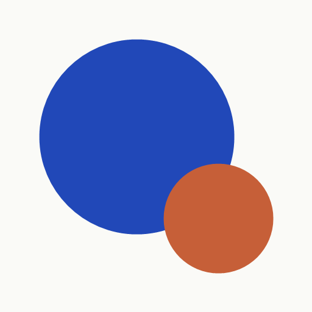
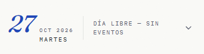
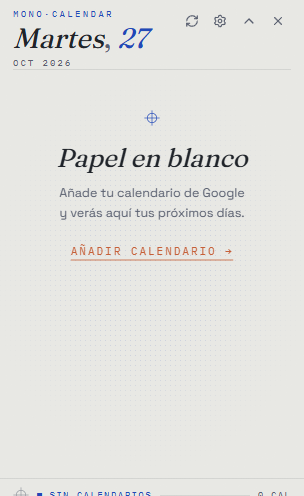
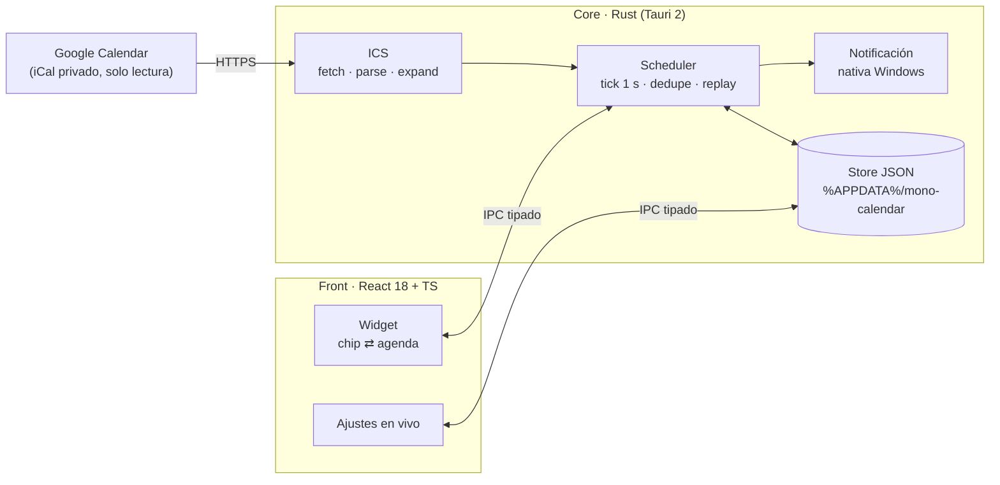

<br />

<p align="center">
  
</p>

<h1 align="center">mono·calendar</h1>

<p align="center">
  <em>La agenda del día, impresa sobre tu escritorio.</em><br/>
  Widget de calendario para Windows que lee tu feed privado de Google Calendar
  (iCal, solo lectura) y anuncia cada cita <strong>antes de que ocurra</strong> —
  silencioso, liviano y con estética editorial en dos tintas.
</p>

<p align="center">
  <a href="./LICENSE"></a>
  
  
  
  
  
  
</p>

---

<p align="center">
  &nbsp;&nbsp;
  <br/>
  <sub>El chip contraído vive sobre tu escritorio · la agenda expandida abre con estado editorial</sub>
</p>

## ¿Por qué mono·calendar?

Los calendarios de escritorio suelen ser aplicaciones pesadas que exigen
ventana, cuenta y atención. **mono·calendar** es lo contrario: un chip
flotante del tamaño de una línea de titular que vive sobre tu escritorio,
muestra *solo lo que falta por ocurrir* y te avisa con una notificación
nativa de Windows a tiempo — sin instalar cuentas, sin sincronizar nada más
que tu feed iCal privado, sin salir de tu equipo.

- **Solo lectura y 100 % local.** Conecta la «dirección secreta en iCal» de tu
  Google Calendar; el widget descarga, interpreta y Agenda. Nada sale de tu
  máquina más allá de esa descarga.
- **Recordatorios que sobreviven a todo.** El planificador persiste cada aviso
  en disco antes de dispararlo: si el widget se reinicia, descubre lo pendiente
  y lo entrega o lo marca como perdido. Nunca duplica, nunca olvida en silencio.
- **Presupuesto de recursos medidos** (build release, Windows 11): RAM **34,6 MB**
  en reposo, arranque **633 ms** hasta ventana visible, CPU ≈ **0 %** en reposo,
  binario **10,7 MB**, instalador NSIS **3,1 MiB** — todos los gates de la
  constitución del proyecto, verificados.
- **Una estética con nombre propio.** Papel, dos tintas (cobalto dominante,
  terracota como acento), grano e imprenta: la interfaz podría ser una página
  de revista sobre tu monitor.

## Características

| | |
|---|---|
| 🗓 **Agenda viva** | Chip contraído con fecha grande + próximo evento; al expandir, HOY y próximos 8 días agrupados por día con recorte «+N más». |
| ⏰ **Recordatorios fiables** | Aviso configurable (10 min por defecto) + aviso temprano opcional; dedupe por firma `{identidad}@{margen}`; cancelación reactiva si el evento se mueve, se elimina o cambia el margen (≤ 1 s). |
| ♻️ **Recurrencia real** | Parser y expansor ICS propios sobre el subconjunto RFC 5545 que exporta Google: `DAILY`, `WEEKLY+BYDAY`, `MONTHLY`, `INTERVAL`, `UNTIL`, `COUNT`, `EXDATE`, `RECURRENCE-ID` y TZID (DST correcto por instante absoluto UTC). |
| 🎛 **Personalización en vivo** | Tres sustratos de papel, tres tamaños, opacidad, margen de aviso y frecuencia de refresco; cada cambio se aplica al instante y persiste. |
| 🩺 **Salud visible** | Cada feed reporta `sincronizado / error / sin conexión`; la barra de estado combina texto + marca no cromática (nunca solo color), y los datos en caché sobreviven a la caída de red. |
| 🖱 **Comportamiento de escritorio** | Arrastre libre con posición memorizada, colapso/expansión animada, click-through real en zonas transparentes, atajo global `Ctrl+Alt+C` (editable) y autoarranque con Windows. |
| 🌐 **Formato local** | Interfaz y mensajes en español; hora local en pantalla, hora UTC por dentro (DST-proof). |

## Filosofía de diseño — mono·color

mono·calendar sigue el sistema **mono·color**: un solo sustrato de papel,
como máximo dos tintas con roles fijos, texturas dosificadas y
prescindibles, tipografía con tres voces y movimiento sobrio.

<p align="center">
  
  
  
  
</p>

- **Fraunces itálica** para las fechas monumentales (la voz de portada).
- **Space Grotesk** para el cuerpo de la agenda.
- **IBM Plex Mono** para horas, etiquetas técnicas y contadores.
- Grano de papel y tramas *halftone* con opacidad mínima; al retirarlas la
  interfaz sigue funcionando igual (una regla dura del sistema).
- `prefers-reduced-motion` elimina todo el movimiento.

## Arquitectura



El núcleo decide *cuándo* avisar; el front solo *muestra*. Los recordatorios
se calculan sobre instantes absolutos UTC (nunca matemática de pared), lo que
hace que los avisos sobrevivan cambios de zona horaria, DST y reinicios.

## Empezar

### Requisitos

- Windows 10 u 11 (WebView2 Runtime, incluido en Windows 11)
- [Rust stable (MSVC)](https://rustup.rs)
- Node.js ≥ 20
- Visual Studio Build Tools 2022 (workload «Desktop development with C++»)

### Desarrollo

```powershell
git clone https://github.com/Javiervalenciam/mono-calendar.git
cd mono-calendar
npm install
npm run tauri dev
```

La primera compilación de Rust tarda varios minutos; las siguientes, segundos.

### Conectar tu Google Calendar (solo lectura)

1. En Google Calendar → **Configuración** → *configuración de mi calendario*.
2. Copia la **«Dirección secreta en iCal»** (URL terminada en `.ics`).
3. En mono·calendar → **Ajustes → 01 Calendarios** pega la URL y dale
   **conectar**. Listo: los eventos aparecen en ≤ 10 s.

> La URL secreta equivale a una contraseña de lectura de ese calendario:
> compártela solo con dispositivos de tu confianza. mono·calendar la guarda
> únicamente en tu carpeta de usuario local y la **ofusca** en cualquier
> mensaje de error o registro.

### Compilar instalador

```powershell
npm run tauri build
# → src-tauri/target/release/bundle/nsis/mono-calendar_0.1.0_x64-setup.exe (≈ 3,1 MiB)
```

## Privacidad por diseño

- **Una sola conexión saliente**: la descarga del feed iCal que tú configuras.
  Sin telemetría, sin analytics, sin pings.
- **Un solo lugar de escritura**: `%APPDATA%/mono-calendar/` (settings, feeds,
  recordatorios y caché por feed, con escritura atómica `tempfile + rename`).
- Errores de red con URL **redactada** (`…/calendarios/<redacted>`), jamás la
  dirección secreta completa.
- Los datos en caché permiten trabajar **sin conexión**: la agenda muestra los
  últimos datos y el estado de salud lo declara honestamente.

## Calidad y pruebas

La lógica crítica tiene suite automatizada (23 tests sobre 7 fixtures ICS):

```powershell
cd src-tauri
cargo test
```

- **Parser/expansión**: eventos simples, all-day, `DAILY/COUNT`, `WEEKLY+BYDAY`,
  `MONTHLY`, TZID Bogotá, cruce DST Madrid, `EXDATE`.
- **Scheduler**: creación y conservación de planes, no-duplicación por firma,
  cancelación por evento eliminado, reprogramación por evento movido,
  `missed` al arrancar con plan vencido, gracia de 5 minutos, horizonte 24 h,
  dedupe entre feeds (uid + inicio + título).
- **Storage**: ida y vuelta, sanitizado de rangos, autocura de archivos
  corruptos y tope de 20 entradas en el registro reciente.

## Estructura del proyecto

```text
mono-calendar/
├── src/                    # Front React 18 + TypeScript + Tailwind v4
│   ├── components/         # Widget, AgendaList, EventDetail, SettingsPanel, StatusBar
│   ├── components/editorial/  # RegMark + elipse editorial (gestos de imprenta)
│   ├── lib/                # ipc.ts (puente tipado), time.ts, theme.ts
│   └── styles/             # tokens mono·color, grano, halftone, movimiento
├── src-tauri/              # Core Rust (Tauri 2)
│   ├── src/ics/            # fetch (If-Modified-Since) · parse · expand (RFC 5545)
│   ├── src/scheduler.rs    # plan/dedupe/cancelación/replay — persistencia-first
│   ├── src/store.rs        # %APPDATA% — escritura atómica y autocura
│   ├── src/notify.rs       # toasts nativos (única fuente de avisos)
│   └── tests/              # 23 tests + 7 fixtures ICS
└── specs/                  # Especificación Spec Kit del proyecto
    └── 001-calendar-widget/   # constitución, spec, plan, contratos, quickstart
```

`specs/` documenta el proceso completo con la metodología Spec Kit: la
constitución del proyecto (recursos, fiabilidad, privacidad, diseño y
accesibilidad como gates verificables), los contratos IPC de almacenamiento y
el plan de investigación con sus desviaciones registradas.

## Roadmap

- [ ] Icono en bandeja con menú (mostrar/ocultar, salir)
- [ ] Recordar posición por monitor (multi-pantalla)
- [ ] Vista semana y búsqueda rápida
- [ ] Internacionalización (EN)
- [ ] Acciones en la notificación («empezar ahora», «aplazar»)
- [ ] CI con GitHub Actions (tests en cada push)

## Autor

**Javier Valencia M.** — Colombia 🇨🇴

[GitHub · @Javiervalenciam](https://github.com/Javiervalenciam)

## Licencia

El código se publica bajo [licencia MIT](./LICENSE). Las tipografías y
bibliotecas de terceros conservan sus licencias originales — ver
[THIRD-PARTY-NOTICES.md](./THIRD-PARTY-NOTICES.md).

Los datos de calendario que leas con esta herramienta siguen siendo de su
propietario: mono·calendar no los replica fuera de tu equipo.

<!--
Agradecimientos silenciosos: este proyecto se construyó con la ayuda de
modelos de IA gratuitos y el IDE OpenCode 2.0 — bajo la dirección, las
decisiones de producto y la revisión de Javier Valencia M.
-->
